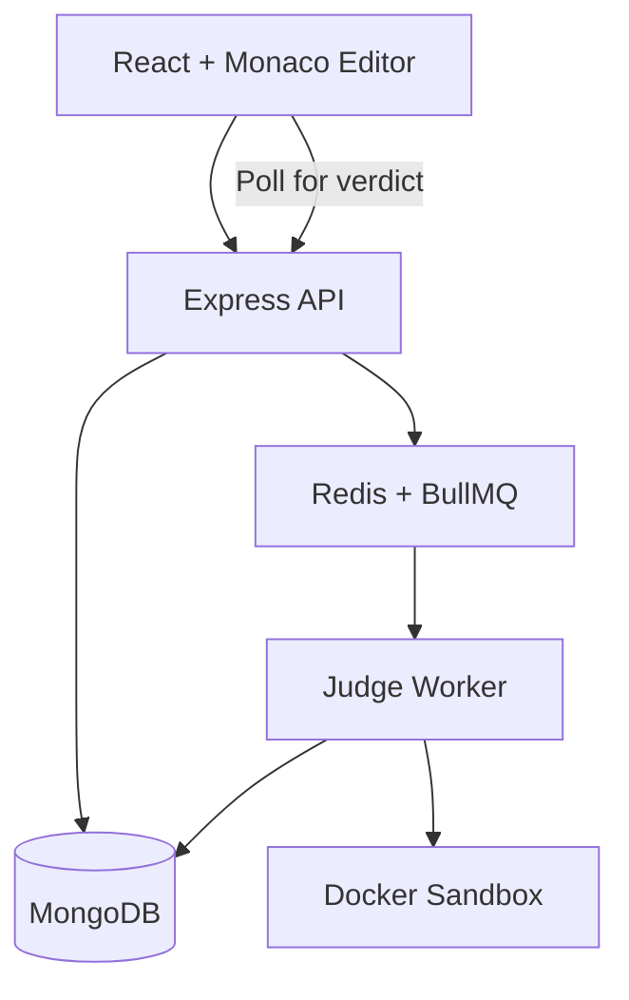

# Nexorithm

**A full-stack coding platform with asynchronous code execution and automated judging.**

Nexorithm lets users solve programming problems, write Python or JavaScript solutions in a Monaco-powered editor, and receive automated verdicts based on test cases.

The project focuses on building a reliable online judge using background workers, container-isolated execution, and durable submission processing.

## Features

- **Coding workspace:** Monaco Editor with Python and JavaScript support.
- **Automated judging:** Test case execution with verdicts such as Accepted, Wrong Answer, and Runtime Error.
- **Asynchronous submissions:** Redis and BullMQ process code submissions without blocking API requests.
- **Isolated execution:** Separate Docker containers with resource and execution limits.
- **Submission history:** Track previous attempts, verdicts, and coding progress.
- **Authentication:** Email and password, or Google sign-in. The API checks the Google ID token and issues the app JWT.
- **Reliability:** Worker recovery, submission reconciliation, and sandbox cleanup.
- **Monitoring:** Prometheus metrics and Grafana dashboards.

## Architecture



**How a submission works**

1. The user submits code from the editor.
2. Express validates and saves the submission in MongoDB.
3. BullMQ schedules the job, and the API returns HTTP 202.
4. A separate worker executes the code against test cases inside Docker containers.
5. The worker stores the verdict in MongoDB.
6. The frontend polls for the result and displays it.

MongoDB keeps submissions durable, while Redis and BullMQ coordinate execution. Workers handle code execution independently of the API.

## Tech Stack

| Layer | Technologies |
|---|---|
| Frontend | React, TypeScript, Vite, Monaco Editor |
| Backend | Node.js, Express, TypeScript |
| Database | MongoDB, Mongoose |
| Job Queue | Redis, BullMQ |
| Code Execution | Docker, Python, JavaScript |
| Authentication | JWT, bcrypt |
| Monitoring | Prometheus, Grafana |
| Testing | Vitest, Playwright |
| Infrastructure | Docker Compose, GitHub Actions |

## Getting Started

**Prerequisites:** Node.js 24, Docker, and Docker Compose.

```bash
git clone https://github.com/anand24mishra/Nexorithm.git
cd Nexorithm

cp .env.example .env
```

Update the example secrets in `.env`, including `JWT_SECRET`, `METRICS_TOKEN`, and `GRAFANA_PASSWORD`.

Prepare the local environment:

```bash
./scripts/prepare-local.sh
```

For local development with Docker Desktop, configure:

```env
SANDBOX_RUNTIME=runc
ALLOW_WEAK_SANDBOX=true
```

These settings are for local testing only, not production use.

Start the services:

```bash
docker compose up --build
```

Initialize the built-in problems:

```bash
docker compose exec backend-api node dist/scripts/migrate.js
```

Open **http://localhost:8080** or your configured `FRONTEND_BIND` port.

## Testing

Run backend tests:

```bash
cd Backend
npm test
npm run typecheck
npm run lint
```

Run frontend tests:

```bash
cd Frontend
npm test
npm run typecheck
npm run build
```

**Latest local verification:** 45 backend unit tests and 18 frontend unit tests passed. Integration, sandbox security, and end-to-end tests are available separately.

## Security and Limitations

Submitted code executes in restricted Docker containers with network, CPU, memory, process, and time limits.

Local execution has been tested using `runc`. The production configuration requires gVisor `runsc`, but execution under `runsc` has not yet been verified.

**Nexorithm is an engineering project, not a production-verified public code execution service.**
