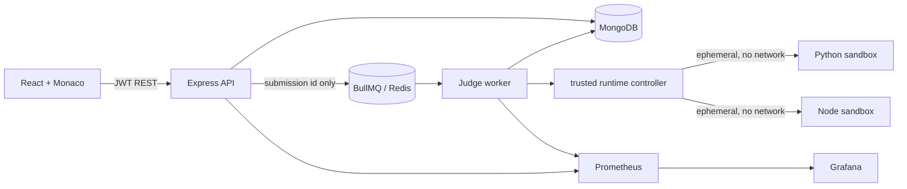

# Architecture

The API validates, persists and queues work but never imports an executor or evaluates submitted code. MongoDB is the durable outbox: a queued record exists before BullMQ enqueue, and reconciliation reconstructs missing jobs. Redis contains only submission and correlation identifiers. The worker resolves the authoritative problem and tests from MongoDB, atomically claims the submission using a lease token, judges it and atomically completes the same lease.

The worker is a trusted controller. It creates a new container for every test, invokes Docker with argument arrays, and applies a non-root user, a read-only root, a bounded tmpfs, no network, dropped capabilities, `no-new-privileges`, pids, memory, CPU, file and output limits. Production requires the gVisor `runsc` runtime and a dedicated runtime daemon over mTLS. The API has no runtime-daemon access. A missing or non-`runsc` runtime fails worker startup in production. Docker Desktop `runc` is a local-only mode and is not this boundary.

Submission records contain lifecycle timestamps, bounded visible results, metrics, retry state and owner. Hidden inputs, expected outputs and output are omitted. Indexes support owner history, problem history and reconciliation scans.
