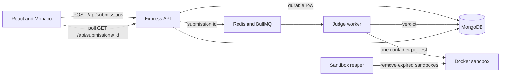

# Architecture

The browser talks only to the Express API. `POST /api/submissions` validates the JWT and the body, inserts a MongoDB submission in the `queued` state, then adds a BullMQ job whose payload is that submission id. The response is HTTP 202. Redis is not the source of truth. If the enqueue is lost, reconciliation scans queued rows and enqueues them again. The same loop expires leases and fails a row after three attempts.

The judge worker does not trust the job body for code or tests. It loads the submission and the problem from MongoDB, claims the row with a lease token, and runs each test in a new container. Completion writes the verdict only when the lease still matches. Hidden inputs and expected outputs are not returned to the client.

The API process does not import `executorFactory`. That split keeps untrusted code off the request path and keeps the Docker socket off the API container. A program that loops, allocates, or exits late can be killed with the container without taking down login or problem reads.

`sandbox-reaper` is defined in `docker-compose.yml`. It removes containers labeled `nexorithm.sandbox=true` when they are past the expiry label and are not covered by a live matching lease. A container that has just exited is left briefly so the worker can read the exit state. Containers without the Nexorithm label are ignored.

Supported languages are JavaScript and Python. The worker image is the Backend `worker` target, which adds the Docker client and starts `dist/queue/worker.js`. The reaper uses that same image with command `node dist/queue/reaper.js`.

`docker-compose.production.yml` does not add a public port. It sets `SANDBOX_RUNTIME=runsc`, `ALLOW_WEAK_SANDBOX=false`, and points the worker and reaper at a Docker daemon over mTLS. That file was not applied to a host in the recorded local verification, and `runsc` was not tested. See [execution-security.md](execution-security.md).
