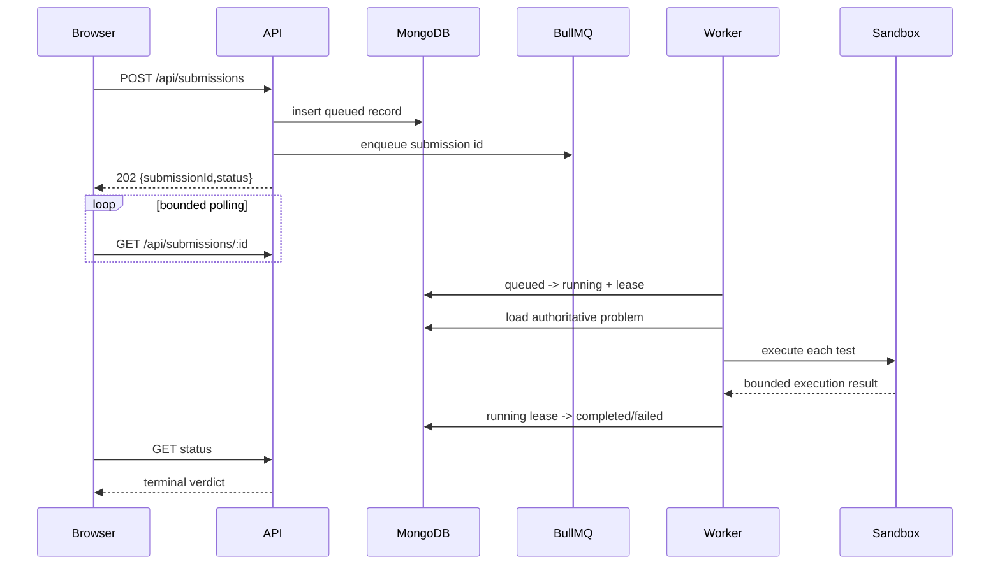

# Submission lifecycle

Allowed transitions are centralized: queued may run, fail or cancel; running may requeue after recoverable infrastructure failure, complete, fail or cancel; terminal records cannot transition. Completion matches both `running` and the current lease token, so duplicate or late workers cannot overwrite a result.

Infrastructure failures are retried at most three times with BullMQ exponential backoff. User verdicts are terminal and are not retried. An expired lease is requeued until its bounded attempt count is exhausted. A reconciliation loop repairs Mongo/Redis enqueue gaps and stale BullMQ terminal jobs.

The browser polls every 1.5 seconds, backs off after fetch errors, stops on terminal status, aborts on unmount/problem change and offers recovery using the saved submission id.
